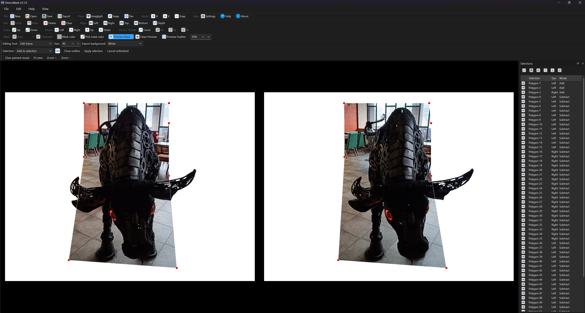

# StereoMask v2.5.0

StereoMask is a Qt 6 application for framing side-by-side stereo photographs and letting selected foreground objects extend outside the stereo window. It edits existing stereo pairs; it does not convert a flat photograph into 3D.



Download the packaged Windows build from the [v2.5.0 release](https://github.com/SRathinaGiri/StereoMask/releases/tag/v2.5.0); extract the complete ZIP before running StereoMask.exe.

## Current Features

- **Alignment grids (new in v2.5.0):** View > Show Grid (Ctrl+G) overlays matching source-image grids in both eyes. Grid Settings controls horizontal/vertical line counts (0-100), single- or two-color contrast and opacity. The grid follows pan/zoom, works in anaglyph, is hidden in Clean Preview and never enters export. Grid preferences are saved locally, not in projects.
- **Three-band Outline Frame (new in v2.5.0):** Edit Frame > Outline Frame adds inner/middle/outer colored bands outside the main frame contour, with a source-pixel gap and independent widths/colors. Each band can follow the current mask color. The outline follows each eye's disparity and curves; preserved foreground covers it. Apply and Display in editor are separate: Clean Preview/export include applied outlines even when editor display is off. Settings are undoable and saved in projects; older projects default to no outline. Existing picture borders/shadows remain independent, and all bands are clipped to the existing canvas. Inspired by the original Stereomasken controls.

- **Left-side toolbox drawers (new in v2.4.0):** A narrow icon rail replaces the stacked top toolbars. File, View, Create Frame, Edit Frame, Out-of-Frame and Help use 150-pixel command drawers with compact inputs and left-aligned borderless buttons. Dropdowns and Open Recent fill the usable drawer width. History uses a compact 240-pixel width for its object list. Click a drawer icon again to close it. Stereo Window and Text & Bubbles open their dialogs directly. Help is last, after Guided Process. One docked drawer opens at a time. Drag a drawer title bar to float it or move it to the other side. Floating drawers remain independent, controls scroll on smaller windows, and the layout is remembered. Hover compact controls for their full labels. View > Layout can close all drawers or reset the toolbox. Existing menus and shortcuts remain available.
- **Quick Access favorites (new in v2.4.0):** Open the star drawer and use its manager to search for commands, add or remove favorites, and reorder them by dragging or with up/down buttons. Save commits the manager changes; Cancel leaves the list unchanged. Right-click any supported command button to add it directly, or right-click a favorite to move/remove it. Favorites retain the original enabled/checked states and dialogs. The list and order persist between sessions in layout.ini.
- **Guided Process:** An optional step-by-step panel guides first-time users from opening an image through stereo-window setup, frame construction, foreground preservation, review, save and export without discarding existing work.
- **History panel:** Applied foreground edits appear as ordered workflow objects with visibility, name, eye, Add/Subtract operation, point editing, movement, reordering and deletion. Undo/Redo continues to cover completed project edits.
- **Creative frame tools:** Create editable rectangles, squares, circles and ovals; add flat, beveled or decorative picture-frame borders; and configure stereo-aware drop shadows.
- **3D Text & Bubbles:** Add multiple stereo-positioned text objects, speech bubbles and thought bubbles with fonts, alignment, colors, opacity, depth, tails and optional foreground occlusion. Text effects include Flat, Embossed and Engraved, on Colored Letters or a Cutout Plate with transparent glyph holes. Both eyes view one consistently rotated plane: X is top/bottom pitch (floor pose), Y is left/right yaw, and Z is clockwise/counterclockwise roll. X/Y perspective produces a stereo depth gradient without vertical misalignment. Stereo depth and relief depth remain separate controls. Effects persist in projects and appear in preview/export.
- **Editable Windows shortcuts:** Help → Keyboard Shortcuts lists the effective bindings and lets users change or disable assignable commands while protecting fixed drawing gestures.
- **Stereo Window adjustment:** Before tracing, shift the original eye images horizontally in the same full-resolution side-by-side layout as the main window, with an optional red/cyan anaglyph preview, pixel controls, zoom/pan and Push Back/Pull Forward buttons. Apply is undoable, saved in the project and used by preview/export without altering the source file.
- **Frame editing:** Add, insert, move and multi-select frame points, set disparity/depth, align and transform points, and edit curves and handles. Directional alignment uses the selected leftmost/rightmost/topmost/bottommost point; depth alignment uses the selected median disparity.
- **Three AutoMask choices:** QTAGENT Rect Decompose, SGBM Contour and Legacy Smart Mask produce editable starting frames using native OpenCV. Check the shape and depth; accuracy is not guaranteed for every photograph.
- **Freehand framing:** Initial strokes are smoothed, simplified and capped to a practical point count. Freehand and AutoMask require an empty frame.
- **Per-eye brushes:** Select Brush preserves painted foreground; Erase Brush removes painted preservation. Adjustable size, visible cursor, bracket-key resizing and stroke Undo/Redo.
- **Fuzzy and color-threshold selection:** Click a pixel to select either its connected color region or every matching color in that eye. A 0–255 RGB tolerance controls the range; each click creates an ordered Add/Subtract History object with Undo/Redo and project persistence.
- **Polygonal and smart lassos:** Straight segments or OpenCV-assisted contrast-edge paths, Add/Subtract operations, and adjustable anchors.
- **Selection objects:** Stable identities, names, physical eye, operation, visibility, anchors and list order in project JSON. The History panel supports Edit points, rename, eye-icon visibility, delete, Move Up/Down and Switch Add/Subtract. Brush strokes are raster objects; old flattened masks import as groups.
- **Ordered holes:** The frame opening is the starting area; visible objects apply top to bottom. Add reveals pixels; Subtract covers them, even inside the frame. A later Add can reopen an earlier subtraction.
- **Anchor insertion/removal:** Shift-click an edge to insert, including closing/magnetic edges. Ctrl-click a point to remove it and reconnect neighbors. Closed polygons retain at least three points. Apply commits changes; Undo restores the previous polygon.
- **Whole-polygon movement:** Select a visible polygon in the History panel and enable Move polygon (four-arrow icon). Drag its interior or edge to translate its shape and all anchors together. Shift-drag moves horizontally only; Escape cancels the drag. Each completed drag is undoable and does not move the former paired partner. The shape stays within its eye image; raster/imported groups are not moved by this polygon tool.
- **Paired lasso:** The connected-circles toggle creates an estimated opposite-eye polygon on new Apply. Source-resolution OpenCV patch matching and disparity fallback assist alignment. Two independent objects remain afterward; inspect and adjust the copied outline.
- **Aligned navigation:** Shared zoom/pan. In frame-point and lasso editing, wheel scrolls vertically, Shift+wheel scrolls horizontally and Ctrl+wheel zooms toward the pointer. Other tools retain wheel zoom. Arrows scroll, Shift+Arrow takes larger steps, Space/Alt/middle-button drag pans, Ctrl+0 fits and Ctrl+Plus/Minus zooms. Unfinished lassos are retained.
- **Operation feedback:** File opening, selection application, color selection, AutoMask, edge refinement, applying text/bubbles, project saving and export show an opaque frameless processing message and current-stage status messages. Single-eye and paired selection operations have distinct messages. Image decoding, paired polygon matching, opposite-eye tracing, color matching, selection-mask composition and applied text-layer rendering run in workers. Applied text layers are cached for subsequent preview/export. Unknown-duration stages do not show guessed percentages.
- **Export-consistent preview:** Preview Result uses the same per-eye compositing as the selected export mode. Match preview uses mask color/opacity; solid cutouts use their chosen background. Transparent SBS preview uses a non-exported checkerboard. Composed eye images are cached.
- **Clean Preview:** F8 hides editing marks, hints and cursors while retaining the selected export appearance. Zoom/pan remain available; turn it off to draw. It does not automatically apply unfinished work.
- **Synced appearance:** Mask color and Pick mask color edit the same value as Settings. The swatch and opacity follow Settings and loaded projects. Sampling does not switch export mode or change custom cutout color.
- **Projects/export:** Editable .msk JSON, optional AutoSave, source-resolution PNG/JPEG output, outer padding and inter-eye gap. Export runs asynchronously and reports completion/failure.
- **Stereo inspection:** Anaglyph honors composed physical-eye masks and the export appearance. Swap changes display order only; export stays left-eye/right-eye.
- **Safety fixes (v2.4.0):** Mac-reviewed processing-panel ownership guards prevent invalid widget deletion when the host closes first. Panel creation avoids queued-command reentry; malformed project text entries are skipped, and old text caches clear on document changes. Fuzzy Select retains Windows eight-neighbor connectivity, including diagonals.
- **Help/updates:** Bundled offline guide, manual Windows GitHub update checking, original-author credits and dependency notices.

## Quick Workflow

1. Open a parallel SBS pair (physical left eye on the left). Convert cross-view source order before importing; display Swap does not convert export order.
2. If needed, open Stereo Window and align the scene plane that should sit at the starting window depth. Apply this before tracing.
3. Create and adjust a frame manually, with Freehand, or with AutoMask.
4. Choose Polygonal lasso or Smart polygon lasso, then Add/Subtract. Zoom/pan to trace. Enable paired lasso if useful.
5. Ctrl+Enter closes and applies a valid outline. Inspect both eyes, especially an automatically aligned copy.
6. Use the History panel to edit, hide, reorder, rename, delete or switch an object's operation.
7. Choose the export appearance, inspect Clean Preview, Save the project, then Export.

## Export Appearance and Colors

| Export background | Result |
| --- | --- |
| Match preview | Mask color blended at the chosen opacity outside the ordered opening. A 95% white mask retains 5% of the original photo there. Default for new images. |
| Transparent (PNG) | Masked pixels become transparent. PNG required. Preview shows a checkerboard; other viewers may use black. |
| Black / White | Fully opaque solid cutout background; mask opacity does not apply. |
| Custom cutout color... | Separately chosen solid cutout color; mask opacity does not apply. |

Existing projects retain their saved mode. Preview Result and Clean Preview honor it; toggling preview does not change export mode. Export omits editing marks and does not depend on view zoom/pan.

**Mask color**, **Pick mask color**, and Settings' **Mask Color/Opacity** are synchronized. **Padding/gap color** fills exported margins/inter-eye gap in Match preview; cutout modes use their selected background for margins too. The picker samples the source image, not arbitrary desktop pixels.

Preview Feather softens the frame boundary in Match preview and its export when enabled. Polygon edges are antialiased; per-object feathering is not implemented.

## Keyboard and Mouse Reference

| Input | Action |
| --- | --- |
| Ctrl+N / Ctrl+O / Ctrl+S | New image / open project / save |
| Ctrl+Shift+E | Export |
| Ctrl+Z / Ctrl+Shift+Z | Undo / redo |
| Enter, keypad Enter, or C | Close lasso without applying |
| Ctrl+Enter | Close and apply a lasso with at least three points |
| Shift-click a lasso edge | Insert a point |
| Ctrl-click a lasso point | Remove that point; closed polygons retain three |
| Delete / Backspace during lasso editing | Remove last anchor and reopen outline |
| Escape | Cancel open lasso; apply closed lasso; cancel color picking |
| F8 | Toggle Clean Preview |
| Ctrl+G | Toggle the editor-only alignment grid |
| Arrow / Shift+Arrow | Scroll both eyes / scroll farther |
| Ctrl+0 / Ctrl+Plus or Equals / Ctrl+Minus | Fit / zoom in / zoom out |
| Wheel / Shift+wheel / Ctrl+wheel | In frame-point and lasso editing: vertical scroll / horizontal scroll / pointer-centered zoom. Other tools retain wheel zoom. |
| Space-drag / Alt-drag / middle-button drag | Aligned pan |
| P / S | Toggle Pan / frame-point Snap |
| [ / ] | Smaller / larger brush |
| Right-click in Edit frame | Add corners in click order. Click within 10 screen pixels of an existing edge to insert a point there. The outline closes to the first corner. |
| Ctrl-click frame dots / Shift-drag selected dots | Change multi-selection / adjust disparity |

Lasso gestures apply to the pending outline or a polygon reopened with Edit points. Keep keyboard focus in the image. Clicking away from a closed outline can apply it and start another; Save/Export also apply closed pending outlines. Explicitly apply and save before quitting.

## Limitations

Smart lasso and paired alignment are assistance, not guaranteed segmentation. Shadows, textures, occlusions, repeated patterns, vertical misalignment and large depth differences can produce wrong boundaries. Pairing searches corresponding rows and retains Y alignment. Inspect both eyes.

AutoMask remains one editable frame boundary, not the complete calibrated multi-region QTAGENT design. Disparity uses resized working images where appropriate; export retains source resolution. Magnetic paths may cap their local working region. Older flattened masks do not contain recoverable separate polygon anchors.

Canvas click-to-select applied polygons, selection groups and per-object feathering are not implemented yet. Current Windows and Mac builds share the expanded workflow, picture-frame, shadow and stereo-text project fields; keep backup copies when exchanging projects with older releases.

## Documentation and Mac Handoff

- [Offline User Guide](docs/user-guide.html): workflows, tools, shortcuts and troubleshooting.
- [Windows/Mac Comparison and Porting Checklist](docs/windows-mac-comparison.md): verified baseline, feature differences, source map, JSON compatibility and port order.
- [Windows v2.5.0 to Mac R20 Handoff](docs/windows-to-mac-handoff.md): current reciprocal feature delta, source map, JSON compatibility and validation checklist.
- [v2.5.0 Release Notes](docs/release-notes-v2.5.0.md): alignment grids and three-band outline frames.
- [v2.4.1 Release Notes](docs/release-notes-v2.4.1.md): shared application/help version and version-specific help cache.
- [v2.4.0 Release Notes](docs/release-notes-v2.4.0.md): toolbox drawers, Quick Access and Mac-reviewed safety fixes.
- [v2.3.0 Release Notes](docs/release-notes-v2.3.0.md): previous text effects, progress feedback, navigation and frame-point fixes.
- [Mac Integration](docs/mac-integration.md): original import provenance.
- [Credits](CREDITS.md): inspiration, collaborators and dependencies.

## Credits and License

**Bernd Paksa**, creator of [Stereomasken](https://www.stereomasken.de/index_en.htm), supplied the original creative stereo-framing ideas.

**S. Rathinagiri (Subbiah Rathinagiri)** maintains the [Windows project](https://github.com/SRathinaGiri/StereoMask). **Theodore Whitten** maintains [StereoMask Mac](https://github.com/TedInVR/StereoMask-Mac) and contributed the foreground-editing foundation imported into Windows. Original development credits include GEMINI CLI and Qt 6; later collaboration includes Codex assistance. The original [MIT license](LICENSE) is retained; binary packages also need dependency notices for Qt/OpenCV and their libraries.

## Build and Test on Windows

Qt 6 Widgets/Gui/Core/Concurrent/Network, CMake 3.16+, C++17, and compatible MinGW/OpenCV runtimes are required. The current local toolchain is Qt 6.11.0, Qt's MinGW 13.1 and vcpkg OpenCV 4.12.0 (x64-mingw-dynamic).

```powershell
$env:PATH = "D:\Qt\6.11.0\mingw_64\bin;D:\Qt\Tools\mingw1310_64\bin;" + $env:PATH
cmake -B build -S . -G "MinGW Makefiles" -DCMAKE_BUILD_TYPE=Release -DSTEREOMASK_BUILD_TESTS=ON
cmake --build build --parallel 4
ctest --test-dir build --output-on-failure
```

CMake uses the compatible OpenCV install at D:\vcpkg\installed\x64-mingw-dynamic when present; supply OpenCV_DIR for another install. Package the executable with Qt/MinGW/OpenCV DLLs, Qt plugins, README, credits, license, guide and dependency notices. Extract the complete ZIP, not only the executable. Help is also embedded in the app.

Five CTest suites cover selection/geometry/export, creative tools, help/UI, update checking and Quick Access. Synthetic tests do not certify segmentation quality on every image or validate Mac packaging.

The application version is defined only in `appversion.h`. CMake reads it for project/bundle metadata and generates the versioned User Guide at `build/generated/docs/user-guide.html`; package that generated guide, not the version-neutral source HTML. Window titles, About, the startup banner and update checks use the same constant. In-app help opens a separate version-specific cache path to avoid reusing older browser help. Changing the header and rebuilding updates all of these displays. Public release notes and `updates.json` remain publication metadata and are updated during release preparation.
